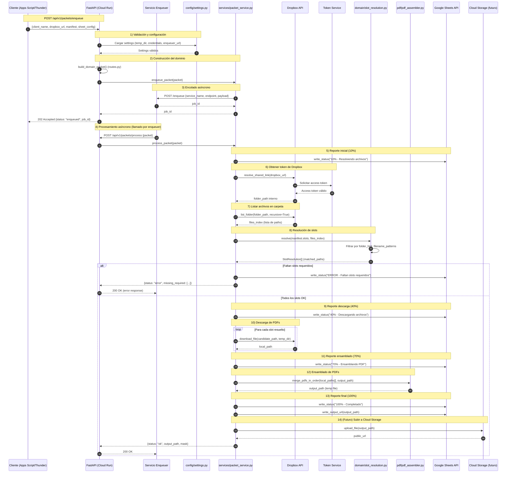
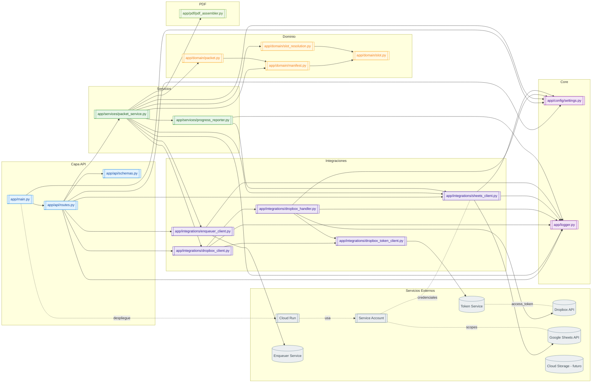

# PDF Packet Service

Microservicio en Python 3.11 + FastAPI para ensamblar PDFs, procesar documentos con OCR y automatizar flujos de trabajo legales con integración completa a Dropbox y Google Sheets.

## 📑 Tabla de Contenidos

- [Características](#-características)
- [Arquitectura](#-arquitectura)
- [Endpoints](#-endpoints)
  - [Packet Endpoints](#packet-endpoints-ensamblado-de-pdfs)
  - [OCR Endpoints](#ocr-endpoints-procesamiento-con-ocr)
- [Configuración](#-configuración)
- [Instalación](#-instalación)
- [Despliegue en Cloud Run](#-despliegue-en-cloud-run)
- [Sistema de Slots](#-sistema-de-slots)
- [Flujo de Integración](#-flujo-de-integración-con-enqueuer)
- [Troubleshooting](#-troubleshooting)
- [Funcionalidades Avanzadas](#-funcionalidades-avanzadas)
- [Estado del Proyecto](#-estado-del-proyecto)
- [Casos de Uso Prácticos](#-casos-de-uso-prácticos)

## 📋 Características

### Core Features
- ✅ **Ensamblado de PDFs**: Combina múltiples PDFs en orden usando `pypdf`
- ✅ **Sistema de Slots**: Manifest flexible para definir qué documentos incluir
- ✅ **Resolución inteligente**: Mapea archivos de Dropbox a slots usando folder hints, file hints y patrones
- ✅ **Integración Dropbox**: Descarga y subida automática desde/hacia carpetas compartidas
- ✅ **Reporte en Google Sheets**: Actualizaciones de progreso en tiempo real
- ✅ **Soporte DOCX**: Conversión automática de archivos Word a PDF
- ✅ **Arquitectura por capas**: Domain, Services, Integrations, API
- ✅ **Enqueuer integration**: Soporte para jobs de larga duración

### OCR Features
- ✅ **Extracción por OCR**: Filtra páginas de un PDF basándose en patrones de texto detectados
- ✅ **OCR por Regiones**: Analiza solo áreas específicas de la página (header, footer, custom)
- ✅ **División de Exhibits**: Separa automáticamente un PDF maestro en múltiples exhibits
- ✅ **Búsqueda Regex**: Soporta patrones complejos con expresiones regulares
- ✅ **Integración OCR + Packet**: Flujo combinado que divide exhibits y ensambla el paquete final

## 🏗️ Arquitectura

```
app/
├── domain/          # Modelos puros y reglas de negocio
│   ├── slot.py           # Definición de Slot y SlotMeta
│   ├── manifest.py       # Manifest con validación y máscaras
│   ├── packet.py         # Packet, SheetOutputConfig, SheetPosition
│   └── slot_resolution.py # SlotResolver con lógica de mapeo
├── services/        # Orquestación y lógica de aplicación
│   ├── packet_service.py        # Servicio principal de ensamblado
│   ├── ocr_extract_service.py   # Servicio de extracción OCR
│   └── progress_reporter.py     # Reporte de progreso
├── integrations/    # Integraciones externas
│   ├── dropbox_handler.py      # Operaciones de Dropbox API
│   ├── dropbox_client.py       # Cliente de alto nivel
│   ├── dropbox_token_client.py # Cliente de tokens
│   ├── sheets_client.py        # Cliente de Google Sheets API v4
│   └── enqueuer_client.py      # Cliente del servicio enqueuer
├── pdf/             # Capa de procesamiento de PDFs
│   ├── pdf_assembler.py  # merge_pdfs_in_order()
│   ├── ocr_engine.py     # Motor OCR con Tesseract
│   └── page_extractor.py # Extracción de páginas específicas
├── api/             # FastAPI routers y schemas
│   ├── routes.py    # Endpoints HTTP
│   └── schemas.py   # Pydantic models
├── config/          # Configuración
│   └── settings.py  # Settings con pydantic-settings
└── logger.py        # Logging configurado
```

### 1) Vista general (flujo funcional)



### 2) Vista técnica (módulos y dependencias)



## 🚀 Endpoints

### Packet Endpoints (Ensamblado de PDFs)

#### `POST /api/v1/packets/enqueue`

Encola un paquete para procesamiento asíncrono (respuesta inmediata).

**Request:**
```json
{
  "client_name": "Jane Doe",
  "dropbox_url": "https://www.dropbox.com/scl/fo/...",
  "sheet_output_config": {
    "spreadsheet_id": "1abc...",
    "sheet_name": "VAWA"
  },
  "sheet_position": {
    "row": 12,
    "col_output": 5,
    "col_status": 6
  },
  "manifest": [
    {
      "slot": 1,
      "name": "Exhibit A – Cover",
      "required": true,
      "folder_hint": "EXHIBIT 1",
      "file_hint": "cover",
      "filename_patterns": ["cover*.pdf"],
      "tags": ["important"],
      "allow_docx": false
    }
  ]
}
```

**Response (202 Accepted):**
```json
{
  "status": "enqueued",
  "message": "Job enqueued successfully for client Jane Doe",
  "job_id": "job-abc123"
}
```

#### `POST /api/v1/packets/process`

Procesa un paquete de forma síncrona (usado por el enqueuer).

**Response (200 OK):**
```json
{
  "status": "completed",
  "message": "Processed packet for Jane Doe. Output: /Dropbox/path/packet.pdf",
  "job_id": null
}
```

### OCR Endpoints (Procesamiento con OCR)

#### `POST /api/v1/packets/ocr-extract`

Extrae páginas específicas de un PDF basándose en un patrón detectado por OCR. Útil para extraer formularios específicos de un paquete grande.

**Caso de Uso**: Extraer todas las páginas que contienen "Form I-485" buscando solo en el pie de página.

**Request:**
```json
{
  "input_pdf_path": "/tmp/vawa_packet.pdf",
  "pattern": "Form I-485",
  "use_regex": false,
  "region_config": {
    "mode": "bottom",
    "height_value": 400
  },
  "suffix": "i485_extracted",
  "case_sensitive": false,
  "dropbox_folder": "/open cases/open cases",
  "ocr_dpi": 300,
  "ocr_lang": "eng"
}
```

**Response (200 OK):**
```json
{
  "ok": true,
  "message": "Successfully extracted 12 pages matching pattern 'Form I-485'",
  "input_pdf_path": "/tmp/vawa_packet.pdf",
  "output_pdf_path": "/tmp/vawa_packet_i485_extracted.pdf",
  "matched_pages": [5, 6, 7, 8, 9, 10, 15, 16, 17, 18, 19, 20]
}
```

#### `POST /api/v1/packets/ocr-split-exhibits`

Divide un PDF maestro en múltiples archivos detectando páginas separadoras (ej. "EXHIBIT A", "EXHIBIT B"). Siempre resuelve el archivo desde Dropbox usando regex.

**Request:**
```json
{
  "dropbox_url": "https://www.dropbox.com/scl/fo/...",
  "dropbox_file_pattern": "^filed copy\\s*-\\s*.+\\.pdf$",
  "dropbox_output_subfolder": "/9 VAWA/strategy",
  "exhibit_page_pattern": "EXHIBIT\\s+([A-Z0-9]+)",
  "ocr_dpi": 300,
  "ocr_lang": "eng"
}
```

**Response (200 OK):**
```json
{
  "ok": true,
  "message": "Created 5 exhibit files.",
  "dropbox_url": "https://www.dropbox.com/scl/fo/...",
  "base_file_path": null,
  "created_files": {
    "EXHIBIT_A": "/open cases/client/9 VAWA/strategy/filed_copy_EXHIBIT_A.pdf",
    "EXHIBIT_B": "/open cases/client/9 VAWA/strategy/filed_copy_EXHIBIT_B.pdf",
    "EXHIBIT_C": "/open cases/client/9 VAWA/strategy/filed_copy_EXHIBIT_C.pdf"
  }
}
```

#### `POST /api/v1/packets/process-with-exhibits`

Endpoint combinado que primero ejecuta el split de exhibits y luego ensambla el paquete final. Combina la funcionalidad de `ocr-split-exhibits` + `process`.

**Request:**
```json
{
  "client_name": "Jane Doe",
  "dropbox_url": "https://www.dropbox.com/scl/fo/...",
  "base_file_pattern": "^filed copy\\s*-\\s*.+\\.pdf$",
  "exhibit_page_pattern": "EXHIBIT\\s+([A-Z0-9]+)",
  "exhibits_output_subfolder": "/9 VAWA/strategy",
  "sheet_output_config": {
    "spreadsheet_id": "1abc...",
    "sheet_name": "VAWA"
  },
  "sheet_position": {
    "row": 12,
    "col_output": 5,
    "col_status": 6
  },
  "manifest": [
    {
      "slot": 1,
      "name": "Exhibit A",
      "required": true,
      "folder_hint": "9 VAWA/strategy",
      "file_hint": "EXHIBIT_A"
    }
  ],
  "ocr_dpi": 300,
  "ocr_lang": "eng"
}
```

**Response (200 OK):**
```json
{
  "status": "ok",
  "exhibits_created": {
    "EXHIBIT_A": "/Dropbox/.../EXHIBIT_A.pdf",
    "EXHIBIT_B": "/Dropbox/.../EXHIBIT_B.pdf"
  },
  "packet_output_path": "/Dropbox/.../packet_Jane_Doe.pdf",
  "mask": "11011",
  "missing_required": []
}
```

## ⚙️ Configuración

### Variables de entorno (.env)

```bash
# Service name
PACKET_APP_NAME=pdf-packet-service

# Dropbox integration
PACKET_DROPBOX_TOKEN_SERVICE_URL=https://accesstokendropbox-xxx.run.app/api/v1/token
PACKET_DROPBOX_SERVICE_SIGNATURE=930xY0dJ0pD

# Google Sheets integration
PACKET_GOOGLE_CREDENTIALS_PATH=/path/to/service-account.json

# GCP configuration
PACKET_GCP_PROJECT_ID=my-project-id

# Storage
PACKET_TEMP_DIR=/tmp

# Enqueuer integration (opcional)
PACKET_ENQUEUER_SERVICE_URL=https://enqueuer-xxx.run.app

# OCR Configuration (opcional - usa defaults si no se especifica)
PACKET_TESSERACT_CMD=/usr/bin/tesseract  # Ruta al ejecutable de Tesseract
PACKET_POPPLER_PATH=/usr/bin             # Ruta a poppler-utils (pdf2image)
```

### Service Account de Google

1. Crear service account en GCP Console
2. Habilitar Google Sheets API
3. Descargar JSON de credenciales
4. Compartir las Sheets con el email del service account

## 📦 Instalación

### Requisitos del Sistema

**Para OCR (requerido para endpoints ocr-*)**:
- **Tesseract OCR**: Motor de reconocimiento óptico de caracteres
- **Poppler**: Utilidades para conversión PDF a imagen

```bash
# Ubuntu/Debian
sudo apt-get update
sudo apt-get install -y tesseract-ocr tesseract-ocr-eng poppler-utils

# macOS
brew install tesseract poppler

# Verificar instalación
tesseract --version
pdfinfo -v
```

**Para conversión DOCX (opcional)**:
```bash
# Ubuntu/Debian (si usas DOCX)
sudo apt-get install -y libreoffice

# macOS
brew install libreoffice
```

### Instalación Local

```bash
# Crear entorno virtual
python -m venv venv
source venv/bin/activate  # En Windows: venv\Scripts\activate

# Instalar dependencias Python
pip install -r requirements.txt

# Configurar variables de entorno
cp .env.example .env
# Editar .env con tus credenciales

# Ejecutar servidor
uvicorn app.main:app --reload --host 0.0.0.0 --port 8000

# Abrir documentación interactiva
# http://localhost:8000/docs
```

### Docker

```bash
# Build (asegúrate de que el Dockerfile incluye tesseract y poppler)
docker build -t pdf-packet-service .

# Run
docker run --env-file .env -p 8000:8000 pdf-packet-service
```

**Nota**: El Dockerfile debe incluir:
```dockerfile
# Instalar dependencias del sistema para OCR
RUN apt-get update && apt-get install -y \
    tesseract-ocr \
    tesseract-ocr-eng \
    poppler-utils \
    libreoffice \
    && rm -rf /var/lib/apt/lists/*
```

## ☁️ Despliegue en Cloud Run

### Con gcloud CLI

```bash
# Configurar proyecto
export PROJECT_ID=my-project-id
gcloud config set project $PROJECT_ID

# Build imagen
gcloud builds submit --tag gcr.io/$PROJECT_ID/pdf-packet-service

# Deploy a Cloud Run (con recursos aumentados para OCR)
gcloud run deploy pdf-packet-service \
  --image gcr.io/$PROJECT_ID/pdf-packet-service \
  --platform managed \
  --region us-central1 \
  --allow-unauthenticated \
  --timeout 3600 \
  --memory 4Gi \
  --cpu 2 \
  --set-env-vars PACKET_DROPBOX_TOKEN_SERVICE_URL=https://... \
  --set-env-vars PACKET_DROPBOX_SERVICE_SIGNATURE=930xY0dJ0pD \
  --set-env-vars PACKET_GOOGLE_CREDENTIALS_PATH=/secrets/credentials.json

# IMPORTANTE: Montar secret con service account credentials
gcloud run services update pdf-packet-service \
  --update-secrets /secrets/credentials.json=google-credentials:latest
```

**Nota**: Para operaciones OCR se recomienda:
- Memoria: 4Gi (mínimo 2Gi)
- CPU: 2 cores
- Timeout: 3600s (1 hora) para PDFs grandes

## 🔧 Sistema de Slots

### ¿Qué es un Slot?

Un **slot** representa un documento esperado en el PDF final:

```python
{
  "slot": 1,              # Posición en el PDF (1, 2, 3, ...)
  "name": "Cover Page",   # Nombre descriptivo
  "required": true,       # ¿Es obligatorio?
  "folder_hint": "EXHIBIT 1",  # Carpeta donde buscar
  "filename_patterns": ["cover*.pdf", "petition.pdf"],  # Patrones
  "tags": ["important"]   # Etiquetas libres
}
```

### Lógica de Resolución

El `SlotResolver` mapea slots a archivos reales:

1. **Filtro por carpeta**: Si `folder_hint` está presente, busca en carpetas que contengan ese texto
2. **Filtro por patrones**: Si `filename_patterns` está presente, aplica wildcards o regex
3. **Filtro por extensión**: Solo archivos `.pdf`
4. **Selección**: Toma el primer candidato encontrado

**Ejemplo:**

```
Dropbox structure:
  /EXHIBIT 1/
    cover.pdf         ← Match!
    petition.pdf
  /EXHIBIT 2/
    abuse_doc.pdf

Slot:
  slot=1, folder_hint="EXHIBIT 1", patterns=["cover*.pdf"]

Resolution:
  ✅ Match: /EXHIBIT 1/cover.pdf
```

### Patrones soportados

- **Literal**: `"petition.pdf"` → busca "petition" en el nombre
- **Wildcard**: `"petition*.pdf"` → petition_v1.pdf, petition_final.pdf
- **Regex**: `"regex:petition_[0-9]+\\.pdf"` → petition_1.pdf, petition_2.pdf

## 🔄 Flujo de Integración con Enqueuer

```
┌─────────────┐      ┌─────────────┐      ┌──────────────────┐
│ Apps Script │ ───> │  Enqueuer   │ ───> │  PDF Packet Svc  │
└─────────────┘      └─────────────┘      └──────────────────┘
       │                    │                       │
       │ POST /enqueue      │ POST /process         │
       │                    │                       │
       └──── job_id ────────┘                       │
                                                     │
                           ┌─────────────────────────┘
                           │
                           ▼
                    ┌──────────────┐      ┌────────────────┐
                    │   Dropbox    │◄─────┤ Google Sheets  │
                    │ (Descargas)  │      │  (Progreso)    │
                    └──────────────┘      └────────────────┘
```

### Ejemplo de progreso reportado

Durante `process_packet()`, el servicio actualiza la celda de status:

```
10% - Resolviendo archivos
40% - Descargando archivos
70% - Ensamblando PDF
100% - Completado
```

## 📝 Ejemplo de Manifest VAWA

```json
{
  "manifest": [
    {
      "slot": 1,
      "name": "Exhibit A – Cover",
      "required": true,
      "folder_hint": "EXHIBIT 1",
      "filename_patterns": ["cover.pdf"]
    },
    {
      "slot": 2,
      "name": "Exhibit A – Petition",
      "required": true,
      "folder_hint": "EXHIBIT 1",
      "filename_patterns": ["petition*.pdf"]
    },
    {
      "slot": 3,
      "name": "Exhibit B – Evidence",
      "required": false,
      "folder_hint": "EXHIBIT 2"
    },
    {
      "slot": 4,
      "name": "Exhibit C – Police Report",
      "required": true,
      "folder_hint": "EXHIBIT 3",
      "filename_patterns": ["police*.pdf", "rap_sheet.pdf"]
    },
    {
      "slot": 5,
      "name": "Exhibit D – GMC Records",
      "required": true,
      "folder_hint": "EXHIBIT 4/GMC"
    }
  ]
}
```

## 🐛 Troubleshooting

### Errores de Dropbox

**Error: "DropboxHandler not available"**
- Verificar que `PACKET_DROPBOX_TOKEN_SERVICE_URL` esté configurado
- Verificar que el servicio `accesstokendropbox` esté corriendo
- Verificar la firma `PACKET_DROPBOX_SERVICE_SIGNATURE`

**Error: "Failed to resolve Dropbox shared link"**
- Verificar que la URL sea un link compartido válido (`/scl/fo/...`)
- Para cuentas de equipo, asegurar que el token tenga acceso al namespace correcto

### Errores de Google Sheets

**Error: "SheetsClient service not initialized"**
- Verificar que `PACKET_GOOGLE_CREDENTIALS_PATH` apunte al JSON válido
- Verificar que el service account tenga permisos en la Sheet
- Habilitar Google Sheets API en GCP Console

### Errores de OCR

**Error: "TesseractNotFoundError"**
- Verificar que Tesseract esté instalado: `tesseract --version`
- En producción, configurar `PACKET_TESSERACT_CMD` con la ruta correcta

**Error: "pdf2image exceptions"**
- Verificar que poppler-utils esté instalado: `pdfinfo -v`
- En producción, configurar `PACKET_POPPLER_PATH` con la ruta correcta

**OCR lento o consume mucha memoria**
- Reducir DPI de OCR (default: 300, mínimo: 150)
- Procesar PDFs en lotes más pequeños
- Aumentar recursos en Cloud Run (memoria y CPU)

**No se detectan patrones esperados**
- Verificar que el patrón sea correcto (usar regex tester)
- Probar con `case_sensitive: false`
- Usar región específica (`bottom`, `top`) para evitar noise
- Revisar calidad del PDF (escaneos de mala calidad afectan OCR)

### Errores de PDF

**PDFs corruptos**
- El servicio usa `pypdf` con `strict=False` para PDFs problemáticos
- Si persiste, considerar migrar a `pikepdf` (requiere cambios en `pdf_assembler.py`)

**Error al convertir DOCX**
- Verificar que LibreOffice esté instalado (Linux)
- Verificar que `docx2pdf` esté instalado (Windows/macOS)
- Revisar que el archivo DOCX no esté corrupto

### Errores de Slots

**"Missing required slots"**
- El sistema ahora continúa con slots opcionales aunque falten requeridos
- Revisar logs para ver qué archivos se buscaron y no se encontraron
- Verificar que `folder_hint` y `file_hint` sean lo suficientemente específicos
- Verificar estructura de carpetas en Dropbox


## 🔧 Funcionalidades Avanzadas

### OCR por Regiones

El sistema permite analizar solo áreas específicas de cada página para mejorar la precisión y evitar falsos positivos:

- **full_page**: Analiza toda la página (default)
- **bottom**: Analiza solo el pie de página (útil para formularios con ID en footer)
- **top**: Analiza solo el encabezado
- **custom**: Define altura personalizada en píxeles o porcentaje

**Ejemplo**: Buscar "Form I-485" solo en los últimos 400px de cada página:
```json
{
  "region_config": {
    "mode": "bottom",
    "height_value": 400
  }
}
```

### División Inteligente de Exhibits

El servicio puede detectar automáticamente páginas separadoras como "EXHIBIT A", "EXHIBIT B" y dividir un PDF maestro en archivos individuales:

1. Aplica OCR a todo el documento
2. Detecta páginas que contienen el patrón (ej: `EXHIBIT\s+([A-Z0-9]+)`)
3. Calcula rangos de páginas para cada exhibit
4. Genera PDFs individuales
5. Sube los archivos a Dropbox con nombres descriptivos

### Resolución de Archivos Mejorada

El sistema usa un enfoque de búsqueda flexible con tres niveles:

1. **folder_hint**: Filtra carpetas por coincidencia parcial (no exacta)
2. **file_hint**: Filtra nombres de archivo por coincidencia parcial (no exacta)
3. **filename_patterns**: Aplica patrones adicionales (wildcards o regex)

**Ejemplo**:
```json
{
  "folder_hint": "vawa",
  "file_hint": "prima facie",
  "filename_patterns": ["*.pdf"]
}
```

Esto encontrará archivos como: `/9 VAWA/strategy/prima facie renewed.pdf`

### Soporte para DOCX

El servicio convierte automáticamente archivos Word a PDF durante el ensamblado:

- En Linux: Usa LibreOffice (comando `soffice`)
- En Windows/macOS: Usa biblioteca `docx2pdf`

Para habilitar DOCX en un slot:
```json
{
  "slot": 3,
  "name": "Cover Letter",
  "allow_docx": true
}
```

## 📚 Estado del Proyecto

### ✅ Completado

**Core Functionality**
- Arquitectura por capas limpia (Domain, Services, Integrations, API)
- Integración completa con Dropbox (handler + token service)
- SlotResolver funcional con folder hints, file hints y patrones
- Google Sheets client con API v4
- ProgressReporter integrado en el flujo
- Cliente HTTP para servicio enqueuer
- Manejo robusto de errores en endpoints
- Soporte para archivos DOCX con conversión automática

**OCR Features**
- Motor OCR con Tesseract y pdf2image
- Extracción de páginas por patrón de texto
- OCR por regiones (full_page, top, bottom, custom)
- División automática de exhibits
- Flujo combinado exhibits + packet assembly
- Búsqueda con regex y búsqueda literal
- Subida automática de resultados a Dropbox

**Dropbox Integration**
- Resolución de shared links
- Descarga de archivos con estructura recursiva
- Subida de archivos con opción de sobrescritura
- Creación de shared links para outputs
- Búsqueda de archivos por regex (folder y filename)
- Soporte para búsquedas no exactas (fuzzy matching)

### 🚧 Próximos Pasos

**Mejoras de Infraestructura**
- [ ] Implementar retry logic para descargas fallidas de Dropbox
- [ ] Agregar telemetría (Cloud Logging, Cloud Trace)
- [ ] Implementar rate limiting en endpoints
- [ ] Cache de resultados OCR para PDFs repetidos

**Testing y Calidad**
- [ ] Tests unitarios para servicios core
- [ ] Tests de integración para Dropbox y Sheets
- [ ] Tests end-to-end para flujos completos
- [ ] Validación de PDFs corruptos antes de procesamiento

**Features Adicionales**
- [ ] Soporte para Google Drive como fuente de archivos
- [ ] Subida de outputs a Google Cloud Storage
- [ ] OCR multilenguaje configurable por slot
- [ ] Webhooks para notificación de jobs completados
- [ ] Dashboard de monitoreo de jobs

**Documentación**
- [ ] Guías de uso por caso (VAWA, asylum, family-based)
- [ ] Ejemplos de manifests complejos
- [ ] Troubleshooting detallado
- [ ] API documentation con OpenAPI/Swagger mejorado

## 💡 Casos de Uso Prácticos

### Caso 1: Ensamblado Simple de Paquete VAWA

Ensambla un paquete VAWA a partir de documentos organizados en carpetas de Dropbox.

```json
POST /api/v1/packets/process
{
  "client_name": "Maria Rodriguez",
  "dropbox_url": "https://www.dropbox.com/scl/fo/xxx",
  "sheet_output_config": {
    "spreadsheet_id": "1abc123",
    "sheet_name": "VAWA Cases"
  },
  "sheet_position": {"row": 5, "col_output": 10, "col_status": 11},
  "manifest": [
    {"slot": 1, "name": "I-360", "required": true, "folder_hint": "forms", "file_hint": "i-360"},
    {"slot": 2, "name": "Evidence", "required": true, "folder_hint": "evidence"},
    {"slot": 3, "name": "Declarations", "required": false, "folder_hint": "declarations"}
  ]
}
```

### Caso 2: Extraer Formulario I-485 de un Paquete Grande

Extrae solo las páginas del formulario I-485 de un PDF grande buscando en el pie de página.

```json
POST /api/v1/packets/ocr-extract
{
  "input_pdf_path": "/tmp/full_packet.pdf",
  "pattern": "Form I-485",
  "region_config": {"mode": "bottom", "height_value": 400},
  "suffix": "i485_only",
  "dropbox_folder": "/open cases/Maria Rodriguez"
}
```

### Caso 3: Dividir PDF Maestro en Exhibits

Divide un PDF grande con múltiples exhibits en archivos separados.

```json
POST /api/v1/packets/ocr-split-exhibits
{
  "dropbox_url": "https://www.dropbox.com/scl/fo/xxx",
  "dropbox_file_pattern": "^filed.*copy.*\\.pdf$",
  "dropbox_output_subfolder": "/9 VAWA/strategy",
  "exhibit_page_pattern": "EXHIBIT\\s+([A-Z])"
}
```

### Caso 4: Flujo Completo - Split + Assembly

Divide exhibits y ensambla el paquete final en una sola operación.

```json
POST /api/v1/packets/process-with-exhibits
{
  "client_name": "Carlos Garcia",
  "dropbox_url": "https://www.dropbox.com/scl/fo/xxx",
  "base_file_pattern": "filed copy.*\\.pdf",
  "exhibits_output_subfolder": "/9 VAWA/strategy",
  "sheet_output_config": {
    "spreadsheet_id": "1abc123",
    "sheet_name": "VAWA Cases"
  },
  "sheet_position": {"row": 8, "col_output": 10, "col_status": 11},
  "manifest": [
    {"slot": 1, "name": "Exhibit A", "required": true, "file_hint": "EXHIBIT_A"},
    {"slot": 2, "name": "Exhibit B", "required": true, "file_hint": "EXHIBIT_B"},
    {"slot": 3, "name": "Exhibit C", "required": false, "file_hint": "EXHIBIT_C"}
  ]
}
```

## 🔗 Recursos Adicionales

### Dependencias Principales

- **FastAPI**: Framework web moderno y rápido
- **pypdf**: Manipulación de archivos PDF
- **Tesseract OCR**: Motor de reconocimiento óptico de caracteres
- **pdf2image**: Conversión de PDF a imágenes
- **Dropbox SDK**: Cliente oficial de Python para Dropbox API
- **Google API Client**: Cliente para Google Sheets API v4
- **Pydantic**: Validación de datos y settings management

### Enlaces Útiles

- [FastAPI Documentation](https://fastapi.tiangolo.com/)
- [Tesseract OCR](https://github.com/tesseract-ocr/tesseract)
- [Dropbox API](https://www.dropbox.com/developers/documentation)
- [Google Sheets API](https://developers.google.com/sheets/api)

## 📄 Licencia

Este proyecto es privado y de uso interno.

---

**Última actualización**: Diciembre 2024
**Versión**: 2.0 (con soporte OCR completo)
